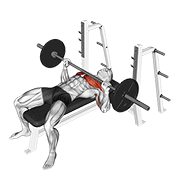
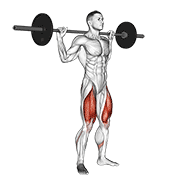
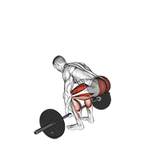

<div align="center">

# 💪 Modelos de Ejercicios de Fit NIc

<p>
  
  
  
  
  
  
</p>

**Capa de modelos y datos de ejercicios para Fit NIc, con 1,324 ejercicios listos para usar. Cada ejercicio incluye GIF animado, miniatura 180x180, categoria, parte del cuerpo, equipo, musculo objetivo, grupo muscular e instrucciones paso a paso en 10 idiomas: ingles, espanol, italiano, turco, ruso, chino, hindi, polaco, coreano y frances.**

[](data/exercises.json)
[](videos/)
[](images/)
[](#-resumen)
[](https://github.com/centeno-2/Flutter_Movil_VI)
[](LICENSE)
[](LICENSE)

</div>

> Creado para **Fit NIc** y mantenido por **Heyner Centeno**. Este repositorio contiene los modelos/datos de ejercicios que usa la app movil.

---

## 📦 Fuente de Datos

**Fit NIc usa este repositorio para:**

- 1,324 modelos de ejercicios con categoria, parte del cuerpo, equipo, musculo objetivo y grupo muscular.
- Un GIF animado y una miniatura 180x180 por cada ejercicio, preparados para la app Fit NIc.
- Instrucciones paso a paso en 10 idiomas: 🇬🇧 ingles, 🇪🇸 espanol, 🇮🇹 italiano, 🇹🇷 turco, 🇷🇺 ruso, 🇨🇳 chino, 🇮🇳 hindi, 🇵🇱 polaco, 🇰🇷 coreano y 🇫🇷 frances.
- El visor interactivo (`index.html`) y la guia de configuracion para desarrolladores (`setup.html`).

**Repositorio de la app movil:** [centeno-2/Flutter_Movil_VI](https://github.com/centeno-2/Flutter_Movil_VI)

---

## 📋 Tabla de Contenido

- [Fuente de Datos](#-fuente-de-datos)
- [Resumen](#-resumen)
- [Visor Interactivo y Configuracion](#-visor-interactivo-y-configuracion)
- [Estructura de Archivos](#-estructura-de-archivos)
- [Estadisticas](#-estadisticas)
- [Esquema de Datos](#-esquema-de-datos)
- [Ejercicios de Ejemplo](#-ejercicios-de-ejemplo)
- [Ejemplos de Uso](#-ejemplos-de-uso)
- [Licencia y Uso](#-licencia-y-uso)

---

## 🔍 Resumen

Este conjunto de datos es mantenido por **Heyner Centeno** para **Fit NIc** como una coleccion curada de **1,324 ejercicios de fitness**. Cubre distintos grupos musculares, tipos de equipo y categorias de ejercicios.

Sirve para:

- Alimentar la experiencia de ejercicios y rutinas de Fit NIc.
- Construir APIs, apps moviles o paneles de entrenamiento.
- Crear funciones de busqueda, filtros y recomendaciones.
- Usar datos de entrenamiento en proyectos educativos o prototipos.

Cada ejercicio contiene:

| Campo | Descripcion |
|---|---|
| ID unico | Identificador numerico, por ejemplo `"0001"` |
| Nombre | Nombre descriptivo del ejercicio |
| Categoria | Parte principal del cuerpo |
| Objetivo | Musculo principal trabajado |
| Grupo muscular | Musculos de apoyo o sinergistas |
| Equipo | Equipo requerido, o `body weight` para peso corporal |
| Instrucciones | Pasos para ejecutar el ejercicio |
| Idiomas disponibles | 🇬🇧 ingles · 🇪🇸 espanol · 🇮🇹 italiano · 🇹🇷 turco · 🇷🇺 ruso · 🇨🇳 chino · 🇮🇳 hindi · 🇵🇱 polaco · 🇰🇷 coreano · 🇫🇷 frances |
| Medios | Miniatura 180x180 (`image`) + GIF animado (`gif_url`) por ejercicio |

---

## 🖥️ Visor Interactivo y Configuracion

Este repositorio incluye dos herramientas HTML listas para usar. No requieren servidor; se pueden abrir directamente en el navegador.

> **Nota:** el visor muestra la miniatura 180x180 y el GIF animado de cada ejercicio junto con sus metadatos e instrucciones.

### `index.html` — Visor de Ejercicios

Explorador 100% del lado del cliente:

- Busqueda en vivo sobre los 1,324 ejercicios.
- Filtros por categoria, equipo y musculo objetivo.
- Grid con carga progresiva.
- Modal de detalle con instrucciones, priorizando espanol.

### `setup.html` — Guia de Configuracion

Guia paso a paso para integrar estos modelos en Fit NIc o en un backend relacionado:

1. **Configuracion de base de datos**: SQL `CREATE TABLE` para SQL Server, PostgreSQL, MySQL y SQLite. Tambien genera un archivo `.sql` con los 1,324 `INSERT`.
2. **Integracion API**: ejemplos de cliente en JavaScript, Python, C#, Java, PHP, Go y cURL para consumir tu backend.
3. **Generar backend con IA**: prompt estructurado para crear una API REST con Express.js, FastAPI, ASP.NET Core, Spring Boot, Laravel o Gin.

---

## 📂 Estructura de Archivos

```text
Models_3D/
├── data/
│   ├── exercises.json        # Conjunto de datos completo: 1,324 registros de ejercicios
│   └── exercises.schema.json # JSON Schema (2020-12) para validar los registros
├── images/                  # 1,324 miniaturas 180x180 para Fit NIc
├── videos/                  # 1,324 GIFs animados 180x180 para Fit NIc
├── index.html               # Visor interactivo de ejercicios
├── setup.html               # Guia de configuracion e integracion
├── NOTICE.md                # Aviso de autoria del proyecto
└── README.md
```

### Archivos Clave

- **`data/exercises.json`**: archivo principal. Contiene un arreglo JSON con 1,324 ejercicios y todos sus metadatos.
- **`data/exercises.schema.json`**: JSON Schema para validar el conjunto de datos.
- **`images/`, `videos/`**: miniaturas y GIFs animados 180x180 usados por Fit NIc.
- **`index.html`**: visor independiente para explorar ejercicios.
- **`setup.html`**: guia de importacion a base de datos, integracion API y generacion de backend.
- **`LICENSE`, `NOTICE.md`**: licencia MIT y aviso de autoria del proyecto.

---

## 📊 Estadisticas

| Metrica | Cantidad |
|---|---|
| Total de ejercicios | **1,324** |
| Idiomas de instrucciones | **10** |

### Ejercicios por Parte del Cuerpo

| Parte del cuerpo | Cantidad |
|---|---|
| Brazos superiores | 292 |
| Piernas superiores | 227 |
| Espalda | 203 |
| Cintura | 169 |
| Pecho | 163 |
| Hombros | 143 |
| Piernas inferiores | 59 |
| Antebrazos | 37 |
| Cardio | 29 |
| Cuello | 2 |

### Ejercicios por Equipo

| Equipo | Cantidad |
|---|---|
| Peso corporal | 325 |
| Mancuerna | 294 |
| Polea/cable | 157 |
| Barra | 154 |
| Maquina de palanca | 81 |
| Banda | 54 |
| Maquina Smith | 48 |
| Kettlebell | 41 |
| Con peso adicional | 36 |
| Pelota de estabilidad | 28 |
| Barra EZ | 23 |
| Otros | 83 |

> **Nota:** cerca del 25% de los ejercicios no requieren equipo, ideal para entrenamientos en casa.

---

## 🗂️ Esquema de Datos

Cada registro de `data/exercises.json` sigue esta estructura. Tambien se incluye un [JSON Schema](data/exercises.schema.json) para validacion automatica.

| Campo | Tipo | Descripcion |
|---|---|---|
| `id` | `string` | Identificador numerico unico, por ejemplo `"0001"` |
| `name` | `string` | Nombre del ejercicio |
| `category` | `string` | Categoria o parte del cuerpo, por ejemplo `"upper arms"`, `"chest"`, `"back"` |
| `body_part` | `string` | Parte del cuerpo trabajada |
| `equipment` | `string` | Equipo requerido, por ejemplo `"dumbbell"` o `"body weight"` |
| `instructions.en` | `string` | Instrucciones completas en ingles |
| `instructions.es` | `string` | Instrucciones completas en espanol |
| `instructions.it` | `string` | Instrucciones completas en italiano |
| `instructions.tr` | `string` | Instrucciones completas en turco |
| `instructions.ru` | `string` | Instrucciones completas en ruso |
| `instructions.zh` | `string` | Instrucciones completas en chino |
| `instructions.hi` | `string` | Instrucciones completas en hindi |
| `instructions.pl` | `string` | Instrucciones completas en polaco |
| `instructions.ko` | `string` | Instrucciones completas en coreano |
| `instructions.fr` | `string` | Instrucciones completas en frances |
| `instruction_steps.<lang>` | `array[string]` | Las mismas instrucciones separadas en pasos por idioma |
| `muscle_group` | `string` | Grupo muscular sinergista principal |
| `secondary_muscles` | `array[string]` | Musculos secundarios involucrados |
| `target` | `string` | Musculo objetivo principal |
| `media_id` | `string` | ID original del medio |
| `image` | `string` | Ruta a la miniatura 180x180 |
| `gif_url` | `string` | Ruta al GIF animado 180x180 |
| `attribution` | `string` | Aviso de autoria del paquete: `"Copyright (c) 2026 Heyner Centeno - Fit NIc"` |
| `created_at` | `string` | Fecha de creacion en formato ISO 8601 |

### Registro de Ejemplo

```json
{
  "id": "0001",
  "name": "3/4 sit-up",
  "category": "waist",
  "body_part": "waist",
  "equipment": "body weight",
  "instructions": {
    "en": "Lie flat on your back with your knees bent and feet flat on the ground. ...",
    "es": "Túmbate sobre tu espalda con las rodillas flexionadas y los pies apoyados en el suelo. ...",
    "it": "Sdraiati sulla schiena con le ginocchia piegate e i piedi appoggiati a terra. ..."
  },
  "muscle_group": "hip flexors",
  "secondary_muscles": ["hip flexors", "lower back"],
  "target": "abs",
  "media_id": "2gPfomN",
  "image": "images/0001-2gPfomN.jpg",
  "gif_url": "videos/0001-2gPfomN.gif",
  "attribution": "Copyright (c) 2026 Heyner Centeno - Fit NIc",
  "created_at": "2026-03-18T12:31:32.854798+00:00"
}
```

---

## 🎬 Ejercicios de Ejemplo

> Cada ejemplo incluye miniatura 180x180 (`image`) y GIF animado (`gif_url`) para Fit NIc.

### 1 — Press de banca con barra · Pecho


> **Equipo:** barra · **Objetivo:** pectorales · **Secundarios:** triceps, hombros · **Media ID:** `EIeI8Vf`

El press de banca con barra es un ejercicio base para trabajar pecho y fuerza de empuje. Recluta pectorales, triceps y deltoides anteriores.

**Claves:** retrae y baja las escapulas antes de sacar la barra. Manten los pies firmes, baja con control hacia el pecho medio y empuja con fuerza.

### 2 — Peso muerto con barra · Piernas / Espalda


> **Equipo:** barra · **Objetivo:** gluteos · **Secundarios:** isquiotibiales, espalda baja · **Media ID:** `ila4NZS`

El peso muerto trabaja la cadena posterior y exige buena tecnica de columna, cadera y agarre. Es util para fuerza general y desarrollo muscular.

**Claves:** coloca la barra sobre el medio del pie, lleva la cadera atras, activa el core y manten la barra cerca de las piernas.

### 3 — Sentadilla completa con barra · Piernas


> **Equipo:** barra · **Objetivo:** gluteos · **Secundarios:** cuadriceps, isquiotibiales, pantorrillas, core · **Media ID:** `qXTaZnJ`

La sentadilla completa desarrolla fuerza coordinada en piernas y core. Bajar de forma controlada mejora el trabajo de gluteos e isquiotibiales.

**Claves:** activa el core antes de bajar, alinea rodillas con los pies y empuja desde todo el pie para subir.

### 4 — Curl de biceps con mancuerna · Brazos


> **Equipo:** mancuerna · **Objetivo:** biceps · **Secundarios:** antebrazos · **Media ID:** `NbVPDMW`

El curl con mancuerna permite trabajar cada brazo por separado y ayuda a corregir diferencias de fuerza entre lados.

**Claves:** manten los codos cerca del cuerpo, sube sin balancearte y baja con control.

### 5 — Dominada · Espalda


> **Equipo:** peso corporal · **Objetivo:** dorsales · **Secundarios:** biceps, antebrazos · **Media ID:** `lBDjFxJ`

La dominada es un ejercicio clave para fuerza de tiron en tren superior. Trabaja dorsales, biceps, deltoides posteriores y estabilizadores del core.

**Claves:** inicia desde colgado, baja las escapulas, tira el pecho hacia la barra y controla la bajada.

### 6 — Elevacion lateral con mancuerna · Hombros


> **Equipo:** mancuerna · **Objetivo:** deltoides · **Secundarios:** trapecios · **Media ID:** `DsgkuIt`

La elevacion lateral aisla el deltoides medio y ayuda a construir amplitud en los hombros.

**Claves:** usa una ligera flexion de codos, sube hasta quedar paralelo al piso y baja lento.

---

## 🚀 Ejemplos de Uso

### Python — Cargar y Filtrar

```python
import json

with open("data/exercises.json", "r", encoding="utf-8") as f:
    exercises = json.load(f)

print(f"Total de ejercicios cargados: {len(exercises)}")

# Filtrar por categoria
chest_exercises = [ex for ex in exercises if ex["category"] == "chest"]
print(f"Ejercicios de pecho: {len(chest_exercises)}")

# Filtrar por equipo
bodyweight = [ex for ex in exercises if ex["equipment"] == "body weight"]
print(f"Ejercicios con peso corporal: {len(bodyweight)}")

# Obtener categorias unicas
categories = sorted({ex["category"] for ex in exercises})
print("Categorias:", categories)

# Acceder a instrucciones en espanol
ex = exercises[0]
print(ex["instructions"]["es"])
```

### Python — Cargar con Pandas

```python
import json
import pandas as pd

with open("data/exercises.json", "r", encoding="utf-8") as f:
    data = json.load(f)

df = pd.DataFrame(data)

# Categorias principales por cantidad
print(df["category"].value_counts().head(10))

# Ejercicios con barra para piernas
barbell_legs = df[(df["equipment"] == "barbell") & (df["category"] == "upper legs")]
print(barbell_legs[["name", "target", "equipment"]])
```

### JavaScript / Node.js

```js
const exercises = require("./data/exercises.json");

console.log(`Total de ejercicios: ${exercises.length}`);

// Solo ejercicios de peso corporal
const bodyweight = exercises.filter(ex => ex.equipment === "body weight");
console.log(`Ejercicios con peso corporal: ${bodyweight.length}`);

// Agrupar ejercicios por categoria
const byCategory = exercises.reduce((acc, ex) => {
  acc[ex.category] = (acc[ex.category] || []);
  acc[ex.category].push(ex);
  return acc;
}, {});

// Acceder a instrucciones en espanol
const ex = exercises[0];
console.log(ex.instructions.es);
```

### TypeScript — Uso con Tipos

```typescript
interface Exercise {
  id: string;
  name: string;
  category: string;
  body_part: string;
  equipment: string;
  instructions: {
    en: string;
    es: string;
    it: string;
    tr: string;
    ru: string;
    zh: string;
    hi: string;
    pl: string;
    ko: string;
    fr: string;
  };
  instruction_steps: Record<string, string[]>;
  muscle_group: string;
  secondary_muscles: string[];
  target: string;
  media_id: string;
  image: string;
  gif_url: string;
  attribution: string;
  created_at: string;
}

import exercises from "./data/exercises.json";
const data = exercises as Exercise[];

const primerosEjercicios: Exercise[] = data.slice(0, 6);
console.log("Primeros 6 ejercicios:", primerosEjercicios.map(e => e.name));
```

---

## 📄 Licencia y Uso

Este repositorio es el **paquete de modelos/datos de ejercicios de Fit NIc**: metadatos de ejercicios, instrucciones multilingues y medios 180x180.

- **Codigo, datos, herramientas, documentacion, imagenes y GIFs incluidos en este paquete**: publicados bajo la [Licencia MIT](LICENSE), copyright (c) 2026 Heyner Centeno.
- **Campo `attribution`**: usa `Copyright (c) 2026 Heyner Centeno - Fit NIc`.
- Este repositorio esta adaptado para la app movil **Fit NIc**.
